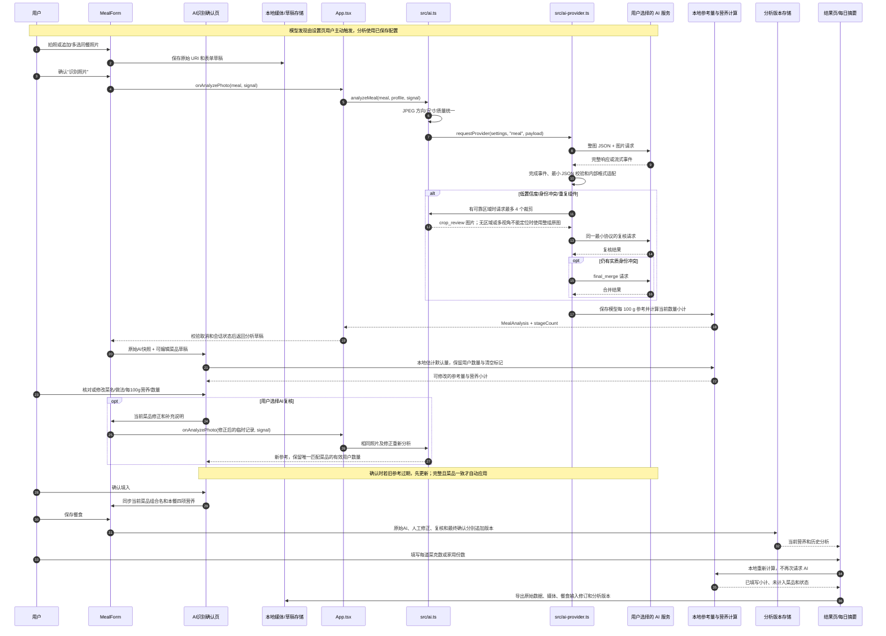
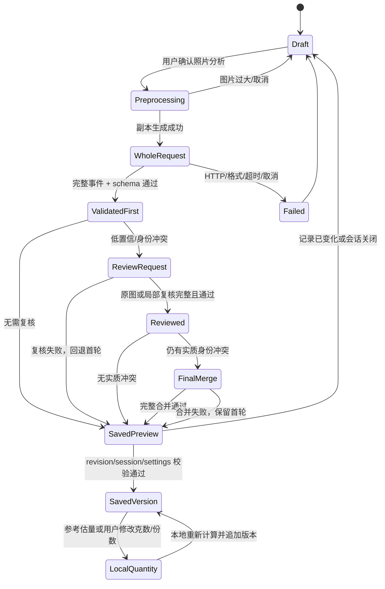

# P2：饮食拍照与营养核心技术报告

- 适用版本：截至 2026-10-21 的首版工作树；不等同于 2026-10-19 已构建 APK
- 所属路线：P2 饮食拍照与营养核心
- 目标：说明从照片进入到分析版本保存、每 100 g 营养参考和用户数量换算的实际技术链路
- 事实来源：`src/`、`shared/`、`server/` 当前代码，以及 [开发记录](development.md)；各轮证据见 [文档索引](README.md)

## 1. P2 的目标和边界

P2 解决两个问题：用户能否从同一餐的一张或多张照片得到可核对的菜品识别，以及确认本地参考量或自行修改数量后能否得到可追溯的营养小计。照片分析产生识别和每 100 g 参考；模型不能把像素转换成实际克数，也不能决定用户吃了多少。本地默认量另行保存估计依据和来源。

P2 包含：

- 相机或相册输入，餐前照片可连续追加或一次多选，同餐最多 4 张源图；旧餐后照片兼容且占一个名额，不再提供新增入口；
- 本地保存原始媒体，生成只用于请求的分析副本；
- 用户配置的 AI 地址、Key、协议、模型和推理强度；
- 上游模型列表和能力发现；
- 整图识别、必要时的局部复核和最终合并；
- 严格的流式完成事件和 JSON 业务校验；
- 菜品级每 100 g AI 营养区间、配方依据、假设和置信度；
- 本地预填可修改的参考量，支持用户克数、可靠家用份数与主动清空，确认后离线计算；
- 分析版本、用户修正和原始照片的独立保存、导出和恢复。

P2 不包含自动称重、从餐后照片推断食用比例、营养治疗建议、在线菜谱检索或固定的开发者 AI 网关。开发网关只服务于本地协议测试和真实验证，手机端直接使用用户选择的服务。

## 2. 端到端链路

以下主链路以新建/编辑表单中的照片识别为例。2026-10-21 已将已保存餐食的“重新分析”接入同一识别/确认/保存流程，并将已确认的逐菜分析纳入版本化餐食草稿。相关关闭重开、数量合并和备份恢复验收见 [开发记录](development.md) 与 [维护审查](maintenance-review.md)。



这条链路中，前半段产生可核对的视觉推断和营养参考，后半段把用户确认的估计量或自行输入的数量转换成摄入估值。模型回复与内部 `MealAnalysis` 分开：模型只填写前端所需内容，程序生成兼容字段、来源、覆盖状态和数量计算；照片重量不作为用户数量。

## 3. 分步实现和步骤关系

### 3.1 建立餐食草稿和输入版本

入口在 `src/ui/meal-form.tsx`。用户拍照或选择相册照片后，原始 URI 通过 `persistMedia` 保存在本机，表单字段由 `useFormDraft` 持久化。`beforeImageUris` 保存有序餐前图，`imageUri` 镜像首图兼容旧记录，`afterImageUri` 只兼容已有餐后图。`mealAnalysisPhotoSources` 统一输入并检查单餐 4 张源图上限；删除首图或全部照片时同步别名，草稿归一化避免旧首图复活。临时 `MealRecord` 带有当前餐次、备注、照片和用户已填文字，供构建本次识别上下文，不覆盖正式记录。

照片改变时清除该照片的待确认与已确认结果，避免旧照片结果回填新输入；时间、餐次和备注修改保留已确认菜品。请求中的表单变化会取消当前请求。新照片结果先进入独立确认页，不改写主表单。保存时将原始模型结果、人工修正和确认版本分别追加为 `AnalysisVersion`，已有历史不被覆盖。

餐食表单通过版本化 `analysisDraft` 持久化已确认快照、菜品数量和主动清空、人工营养覆盖、模型/确认历史及待确认识别编辑。恢复时校验草稿版本与原餐食 ID/修订号；无效或过期草稿不会水合后自动保存覆盖，可由用户重试读取。旧版扁平草稿仍只覆盖自身显式字段，并可从正式餐食恢复既有有效分析。

新建餐食的识别结果尚未确认时，用户可以返回主表单直接保存。保存会将原始 AI 识别作为当前版本，把待核对的名称/数量编辑保留为历史；按身高体重预填的估计数量不会成为已确认摄入，因此当天汇总仍显示未知。没有当前确认结果或用户填写的整餐营养时，单独的历史快照不会触发空白 `local/manual-nutrition` 版本。

### 3.2 生成分析副本，保留原始媒体

`src/ai.ts` 的 `analyzeMeal` 对每个源照片执行本地预处理：

1. 使用 `expo-image-manipulator` 统一为 JPEG，并按宽度 1200 缩放；
2. 压缩质量为 `0.75`，检查 base64 大小不超过 4 MiB；
3. 保留 `before`、`after` 角色，原始媒体 URI 不替换；
4. 复核时如有可靠区域（旧协议可提供），增加约 18% 边距，最小边距为图像尺寸的 3.5%，裁剪后缩放到宽度 900、质量 `0.78`；frontend 协议不要求区域，没有区域时复核原分析副本。多个餐前视角且区域没有源图索引时，禁止裁到首图，改用整组原图；
5. 请求结束后删除位于缓存目录中的临时副本。

这一步的输出是 `data:image/jpeg;base64,...` 请求图片和角色列表。同餐多图一起请求，提示避免把不同视角重复计菜；原图继续由本地记录和备份管理，模型看到的是可控大小的副本。

### 3.3 验证 AI 设置并发现上游能力

`src/ai-provider.ts` 的 `validateAiSettings` 和 `normalizeConnection` 检查：

- API 地址必须是 HTTPS，不能含用户名、密码、查询或片段；
- Key 必须是可打印字符串；
- 协议只能是 Responses 或 Chat Completions；
- 模型 ID 和推理强度必须来自用户选择；
- 不把未声明的视觉或推理能力自行推断为支持。

模型发现请求 `GET /models`，解析模型 ID、展示名、视觉能力和 `reasoning_efforts` 等字段。分页只沿用同一上游端点的游标，不跟随上游返回的任意 URL。推理强度可选择服务默认、上游声明的选项或用户明确自填的 token。选择默认时不发参数；自填值通过格式校验后按原值发送，不由程序映射或降档。没有元数据也允许自填，但不把自填值当成上游已经声明支持；同模型刷新不得静默丢失用户自定义值。

模型发现由设置页操作触发，`requestProvider` 使用已保存配置，不在每次餐食分析前额外获取模型。原生配置保存在 SecureStore，Web 配置独立写入 IndexedDB；事务提交后才提示成功，同一浏览器及 `http://localhost:8081/` 来源重开恢复，健康 ZIP 不含配置或 Key。读取中、读取失败与未配置有不同状态，详见 [AI 设置约定](user-ai-settings.md)。

### 3.4 生成严格餐食请求

生产使用 `mealRecognitionInstructions(..., { promptProfile: 'frontend' })`。每个可单独食用的成品菜或饮品为一个组件，模型只输出：

- 菜名 `label`、做法 `cookingMethod`、识别置信度 `confidence`；
- 每 100 g 四项 `min/max` 营养参考、`typical_recipe` 或 `category` 方法；
- 简短配方依据、估算假设、独立营养置信度和关键不确定项。

根对象只有 `components` 与 `uncertainty`。模型不填写目录 ID、候选列表、坐标、结构化证据、整体菜名、建议、覆盖统计或来源时间。程序在严格校验后补齐内部兼容字段，因此前端和旧数据结构不需要随提示一起大改。未知营养为 `null`，保留菜品或饮品及原因；不能为了缩短输出漏掉整道菜或把未知饮品假定为果汁。

新提示不发送 139 项食物目录。请求文字只包含菜名、备注、用户纠正的菜名/做法和照片角色，不发送无关个人资料及数量。模型仍不得返回照片重量、用户数量、家用单位换算、整餐营养总量或伪造来源。混合菜中的肉、蔬菜、油、酱和糖写进该菜的配方依据，避免在组件层重复计算。

Responses 请求使用 `input_text` 的 `JSON record:` 前缀、`input_image` 图片、`detail: low`（整图）或 `high`（裁剪），`stream: true`、JSON object 格式和 `max_output_tokens: 8192`。Chat Completions 使用等价的 system/user 消息、JSON object 格式和完整 `stop` 响应。

提示有三个显式版本：`frontend` 是生产最小协议，`current` 与 `concise` 保留原识别结构、目录和提示，供旧诊断或受控比较。旧的 concise 只压缩解释篇幅，仍要求候选、证据和区域；新的 frontend 同时减少输入与输出字段。三者适配后沿用同一内部分析结构和营养计算口径，模型及推理强度始终取用户配置。每日综合总结仍使用原来的总结协议。

### 3.5 接收完整响应并进行两层校验

第一层是传输生命周期校验：

- Responses 必须收到 `response.completed`，且其 `response.status` 为 `completed`；
- `response.failed`、`response.incomplete`、拒绝、工具调用、异常内容类型或重复完成事件均失败；
- Chat Completions 必须只有一个 choice，`finish_reason` 必须为 `stop`；
- 增量文本、`[DONE]`、HTTP 200 或流结束本身都不能视为成功；
- 流单事件最多 128 KiB，整条流最多 2 MiB。

第二层是业务校验：

- 带 `{kind, data}` 包装时，`kind` 必须等于 `meal`，且只能有这两个键；未包装的旧格式仍按兼容路径读取；
- frontend 顶层和组件先由 `validateFrontendMealRecognition` 严格校验，未知字段、错误类型、反向营养范围和负数都会拒绝；
- `adaptFrontendMealRecognition` 补齐 `basisGrams: 100`、空的兼容 ID/候选/区域、标题和提示，再进入内部 `MealAnalysis` 校验及计算。`current` / `concise` 继续使用 `validateMealRecognition`，其 ID 和区域检查只属于旧协议；
- 营养数字只能出现在 `nutritionEstimate.per100g`，不能夹带总量、克数、用户数量或本地数据库来源；
- 复核结果必须保留首轮组件，不得借复核删除原来已识别的菜品。

只有两层均通过，才会把模型结果交给营养计算层。有效完成事件到达后立即进入业务校验，流取消和释放独立清理，不等待连接 EOF 或取消 Promise。否则克隆分支或不结束的取消操作可能把已完成结果拖成超时；显式取消、阶段超时和迟到结果保护仍然生效。

真实诊断工具通过 `beforeRequest` 执行发送前的强制预留；该门禁失败返回安全的 `request_not_started`，不能发出供应商请求，进度观察接口不能代替额度门禁。普通用户直连不受开发网关账本约束。`onTransport` 从实际 reader 同步接收响应头、原始字节和结构化事件，测试工具不再使用响应克隆或固定时间快照。`transportCompleted`、`businessAccepted` 和 `captureStatus` 独立保存，失败复核不会因返回首轮而成为成功阶段。

### 3.6 按条件进行局部复核和最终合并

`decideMealReview` 对整图结果检查：

- 内部汇总或组件识别置信度低于约 `0.65`；
- 身份冲突、重复组件、候选无法区分；
- 缺少可用于定位的区域时不生成无效裁剪。

清晰结果只执行整图请求。第二阶段沿用相同的 frontend 协议，没有区域时复核原图，不编造区域；旧协议有可靠区域时一次最多发送 4 个本地裁剪。复核结果与首轮比较，仍有实质身份冲突才执行第三阶段 `final_merge`。内部兼容规则保留组件数量明显变化及已确认 ID 冲突的判断，新协议不要求模型生成 ID。营养区间较宽、油量不明确或营养置信度低本身不会触发第三次请求。

每餐最多三个阶段，不自动重试。第二或第三阶段超时、上游错误、裁剪失败或格式错误时，保留已经通过校验的首轮结果；首轮失败则没有可保存分析。每阶段都会记录阶段编号和 `stageCount`。

### 3.7 生成每 100 g AI 营养参考

`shared/nutrition.mjs` 的 `calculateMealNutrition(..., { mode: 'ai-per100g-v3' })` 把模型的 `nutritionEstimate` 转为持久化的 `ModelNutritionSource`：

```text
source.provider        = "model"
source.basisGrams      = 100
source.method          = "typical_recipe" | "category"
source.per100gRange    = nutritionEstimate.per100g
source.recipeBasis     = nutritionEstimate.recipeBasis
source.assumptions     = nutritionEstimate.assumptions
source.confidence      = nutritionEstimate.confidence
source.model           = 当前模型 ID
source.reasoningEffort = 当前推理强度（若有）
source.generatedAt     = 完成时间
```

该快照保存后，用户只改数量时不会重新查 USDA，也不会让后续代码用本地数据库覆盖模型的每 100 g AI 参考。用户在识别页人工编辑的营养值使用独立字段 `userNutritionPer100g`：未设置沿用来源，`null` 明确未知，四项范围表示人工覆盖。计算优先使用覆盖值，原 `source` 保持不变；该字段只属于本地数据，模型协议不能返回。旧的 USDA / 本地类别分析仍通过兼容模式读取和导出。

模型参考的校验限制包括：热量每 100 g 不超过 900 kcal；蛋白质、碳水和脂肪各不超过 100 g；范围必须有限、非负且 `min <= max`；三项宏量营养素的下限之和不能超过 100 g。

### 3.8 用户数量换算和覆盖状态

原始模型分析的 `userQuantity` 为空。独立识别页通过 `estimateMealPortion` 和 `applyEstimatedMealQuantities` 在本地生成可修改的参考量：有效每日热量目标优先，否则按有效个人体重×25～35 kcal/kg/日，无体重采用一般成人60kg；按餐次比例、当前每100g热量和等克数假设换算各菜区间中点整数。默认量标记 `origin: estimated`，不从照片测量；用户填写或覆盖数量后为 `origin: user`：

- 克数：`grams = userQuantity.amount`；
- 家用份数：`grams = userQuantity.amount × householdMeasure.grams`；
- 家用换算只来自本地维护且带明确克数的表，模型和照片不能生成换算；
- 没有数量、数量为过期参考，或家用单位没有本地换算时，不计入摄入量。

用户主动清空写入本地 `userQuantityCleared: true`，与初次空白区分，刷新、复核或备份恢复后不重新估填。未知菜品、缺失营养、不完整餐食、热量密度过低或推算总量超过2000g时不给自动估量，不补零；显式填写数量仍可用于有可靠参考的部分小计。原始模型版本与默认估量/确认版本分别保存。

旧记录的保存量与原空量冻结恢复，修改资料后仅打开或再次确认不重新估量；新 AI 结果或主动修改菜品/做法/每100g参考、增删菜品才使用当时资料重新估量。确认版本的 `assumptions` 保留详细的每日/餐次热量区间、克数区间、等克数与取中点依据，保存恢复不改写旧依据。数量校正保存成功后清除旧识别草稿缓存，右侧入口始终采用最新校正。

对每项营养素，程序使用以下公式并累加各菜品区间：

```text
component.min = per100g.min × grams / 100
component.max = per100g.max × grams / 100
meal.min       = Σ component.min
meal.max       = Σ component.max
```

`coverage` 同时保存 `referenceCount`、`counted`、`missingQuantityLabels` 和 `unknownNutritionLabels`。没有任何有效数量时四项总量均为 `null`，状态为 `unknown`；有至少一道菜计入时状态为 `approximate`，即使所有菜都填写，也只表示覆盖完整，仍是 AI 近似值。部分填写时界面显示已填写菜品小计，并列出未计入菜品。

### 3.9 保存分析版本并回填界面

`App.tsx` 在提交分析前检查四个一致性条件：

1. 请求没有被取消；
2. App 数据 `sourceVersion` 没有变化；
3. AI 设置版本没有变化；
4. 餐食 ID 和当前 `revision` 仍然存在。

条件不满足时拒绝迟到响应，不覆盖用户的新输入。通过后追加 `AnalysisVersion`，包含 `id`、模型、完成时间、源记录版本、阶段数和 `MealAnalysis`。原始 `MealRecord`、输入修订和旧分析保持不变。

`src/ui/meal-form.tsx` 将新照片结果、可编辑确认草稿和已确认的主表单营养分开管理；`src/ui/meal-review.tsx` 呈现独立“AI 识别”页。用户可增删菜品并修改菜名、做法、四项每 100 g 营养、数量及补充说明。`src/meal-review.ts` 负责草稿校验、身份修改后的旧营养清空、本地计算，以及复核后按唯一菜名/做法合并有效数量；家用单位还要求新旧本地换算一致。

“AI 复核”把修改后的菜品作为修正信息发送，复核原始结果单独留存，完成后仍待确认；失败、取消或返回保留用户编辑，迟到响应不能回填。“确认填入”将当前菜品组合名同步到主表单，包括旧记录和以前手填标题，并按采用的参考量或用户数量换算四项营养。修改菜名/做法使旧参考失效且未补新营养时，确认先发起营养更新；完整有效、菜品集合一致、各菜营养已知且无身份冲突或漏菜才自动确认，结果变化或仍未知时留页核对，失败不自动重试，也不套旧数据。`hasIncompleteMealRecognition` 与食用量估算共用完整性判断，避免同名菜品仍漏掉主食时自动应用。其他唯一同名菜品的人工营养覆盖保留；自动更新允许用户克数或主动清空跨做法描述变化保留，家用份数仍需可靠换算匹配。旧餐只有餐后照片时也可更新，继续保留原图角色。

主表单移除重复菜品确认卡片、份量/参考物和剩余量输入。“营养值（可选）”在备注上方，右侧为“修改本餐食用量”入口；四项可直接修改数值或范围，不把营养范围转成精确中点。`src/meal-nutrition-fields.ts` 解析输入并生成独立 `manual-total-v1` 整餐覆盖版本，原AI和每100g参考仍保存；清空四项后保持未知，非法或不完整输入阻止保存。未经确认返回仍保留主表单原值。

`src/ui/meal-analysis.tsx` 的当前和历史详情使用相同精简展示。无法确认项显示“待确认菜品”，未知营养显示“—”；识别过程、候选、置信度、配方依据及模型信息仅留存在数据和备份中。表单存续期间，每次实际模型返回与人工确认保留独立来源，保存时内容相同也不合并掉来源。已保存餐食重新分析先打开原记录的餐食表单；原有效分析持续参与当天汇总，直到用户确认并保存。只有唯一匹配菜名和做法的菜品沿用原数量；改名、做法变化、重复及身份不明确的菜品需要用户核对。失败、取消、返回、关闭及迟到响应不改变正式记录。保存后原始模型结果、待确认/确认版本及新的有效分析作为独立历史保留。

数量修改只调用本地计算并追加一个本地分析版本，不消耗模型请求。这样模型版本、用户修正和摄入计算可以独立审计。

### 3.10 导出、恢复和模型替换

`src/backup.ts` 生成 ZIP，至少保存：

- 标准化 `data.json`、CSV 和每日 Markdown；
- 原始照片、餐后照片和训练媒体；
- 已持久化的表单字段草稿、已保存分析版本、餐食输入修订、模型来源和用户数量；
- `manifest.json` 中的大小和 SHA-256 校验信息。

AI 连接配置位于独立存储：原生 SecureStore、Web IndexedDB，均不进入健康 ZIP。恢复时先校验路径、大小、哈希和记录引用，再进行非破坏合并；旧版本字段通过兼容迁移读取。照片数组、默认量来源、主动清空、人工营养与估量依据随健康数据保留。由于餐食原始输入、`revisions` 和原始照片仍在备份中，用户未来更换模型后可以重新分析，而不依赖原供应商的历史响应。

## 4. 状态机和失败分支



错误分类和处理方式如下：

| 情况 | 是否接受结果 | 用户可见行为 | 数据处理 |
| --- | --- | --- | --- |
| 相机权限、图片读取或压缩失败 | 否 | 提示原因 | 原始照片和草稿保留 |
| 模型列表失败或设置无效 | 否 | 要求检查地址、Key 或重新选择能力 | 不发餐食请求 |
| HTTP 401/403/429 或其他非 2xx | 否 | 显示认证、额度或上游失败 | App 保留草稿/既有版本；诊断运行另保存阶段失败和账本 |
| HTTP 200 但没有 `response.completed` | 否 | 超时/未完成 | 不回填部分文本；若已有首轮则保留首轮 |
| JSON 包装、schema 或营养范围错误 | 否 | 格式无效 | 不覆盖旧分析；诊断工具保留脱敏原始响应 |
| 第二/第三阶段超时或冲突 | 当前阶段否 | 使用首轮结果并提示可核对 | 首轮分析版本可保存，失败阶段不覆盖 |
| 用户手动取消 | 否 | 显示已取消 | 原始输入保留，可能已产生的供应商费用由供应商决定 |
| 分析期间记录/设置/revision 改变 | 否 | 要求重新发起分析 | 丢弃迟到回写，记录新输入 |
| 没有数量或没有营养参考 | 参考可展示，摄入不计入 | 显示待填写或未知 | 总量保持 `null`，未知不当作 0 |

## 5. 超时、并发和请求额度

客户端 `AI_REQUEST_TIMEOUT_MS` 为 120 秒，每个阶段独立计时；一餐最多三个阶段，App 外层生命周期约为 `120 × 3 + 5 = 365` 秒。独立诊断可通过 `requestProvider` 的 `options.timeoutMs` 显式设置阶段上限，例如 180000 毫秒；普通 App 不传此选项，仍为 120 秒，不会因诊断而延长用户等待。餐前照片、已保存餐食和每日总结用 `AnalysisWaitTime` 根据开始时间和当前时钟每秒刷新累计等待秒数，复核期间不重置；完成、取消、失败或卸载时停止并清理计时器。AbortSignal 同时支持用户取消、页面关闭和超时，取消时会清理流和临时图片，不自动重试。

本机诊断网关可通过显式配置把上游等待提高到 180 秒，但这不是手机端默认策略。本地曾因等待流清理而将完整结果误报为超时，该缺陷已修复；历史缺失原始流的超时不能逐次归因。修复后的四图预试仍有 5 次 max 请求在 HTTP 200 后未于 90 秒内完成，同提示的 medium 请求明显更快，reported reasoning tokens 也大幅减少。完成事件是业务校验的入口，HTTP 200 或中间 reasoning 事件本身不表示分析成功。

历史账本保留当时每餐最多 3 次、每轮最多 25 餐复核的记录，原跨轮累计 75 次停止条件已由用户取消。2026-10-18 已完成的超时试验使用独立上限 22 次：四图三配置共 12 次首轮对照，仅达到至少 3/4 完整有效且无明显内容退化的配置进入 10 图确认，试验不触发复核。该上限不构成新试验授权，也不改变 App 每次分析最多三阶段的生命周期。已预留或发送的阶段不能因重启重发，原始流或账本保存失败须阻断后续诊断请求。

每次尝试记录模型、强度、阶段、HTTP 状态、响应头/首事件/首段正文/完成事件/校验/返回时间及 usage（包括嵌套 reasoning/cache tokens）。原始片段最多 2 MiB；诊断 HTTP 错误时仅采集 reader 在 64 KiB / 50 ms 内观察到的前缀。归档耗时另存，不能进入模型耗时排序或 45 秒验收。原始 Key 及 JSON 转义或截断形式均脱敏，报告不包含凭据。当前真实记录以 [开发记录](development.md) 为准。

## 6. 接口和数据契约摘要

### 6.1 请求输出

`requestProvider` 返回：

```ts
{
  analysis: MealAnalysis;
  model: string;
  createdAt: string;
  stageCount: number;
}
```

生产 frontend JSON 的完整字段形状为（`NutrientRange` 为 `{min: number, max: number}`）：

```ts
{
  components: Array<{
    label: string;
    cookingMethod: string | null;
    confidence: number;
    nutritionEstimate: {
      method: 'typical_recipe' | 'category';
      per100g: { calories: NutrientRange; protein: NutrientRange; carbs: NutrientRange; fat: NutrientRange };
      recipeBasis: string;
      assumptions: string[];
      confidence: number;
    } | null;
    uncertainty: string[];
  }>;
  uncertainty: string[];
}
```

没有列出的字段不得由模型额外返回。热量为 kcal，宏量营养素为 g，基准固定为可食用成品每 100 g。传输 DTO 在共享层定义为 `FrontendMealRecognition`，校验与适配由 `validateFrontendMealRecognition` / `adaptFrontendMealRecognition` 完成；持久化仍使用原 `MealAnalysis` 和来源分支。

### 6.2 持久化对象

- `MealRecord`：原始餐食文字、媒体 URI、时间、餐次、输入修订和分析版本数组；
- `AnalysisVersion`：模型来源、完成时间、源 revision、阶段数和不可变分析快照；
- `MealComponent`：菜品身份、每 100 g `source`、用户数量、家用换算和过期标记；历史候选、证据和区域继续兼容，新模型不必生成；
- `MealCoverage`：匹配数、参考数、计入数、缺少数量和营养未知列表；
- `NutritionSource`：`ai-per100g-v3` 或兼容的 USDA/本地类别计算方式和覆盖状态。

## 7. 验证映射

当前 P2 的检查落点如下，用于定位覆盖；实际执行结果和时间以对应记录为准。

1. **协议和模型层**：`tests/ai-provider.test.ts`、`tests/meal-frontend.test.ts`、`server/streaming.test.mjs`、`server/responses.test.mjs`，覆盖流事件、最小 JSON、完成判定、包装、拒绝和超时语义。
2. **营养和确认层**：`tests/ai-nutrition.test.ts`、`tests/meal-review.test.ts`、`tests/meal-nutrition-fields.test.ts`、`tests/meal-portion-reference.test.ts`、`tests/meal-estimated-quantities.test.ts`，覆盖每 100 g 参考、估量、用户数量、旧量冻结、人工覆盖和未知值。
3. **媒体和持久化层**：`tests/meal-photos.test.ts`、`tests/meal-photo-drafts.test.ts`、`tests/settings-persistence.test.ts`、`tests/backup.test.ts`，覆盖多图、草稿删除、提交失败、历史和 ZIP 往返。
4. **界面层**：`tests/meal-estimated-portion-ui.e2e.ts`、`tests/meal-before-photos-ui.e2e.ts`、`tests/settings-persistence-ui.e2e.ts` 及既有回归，验证实际交互和本地状态；模拟响应不证明真实营养准确性。
5. **诊断和实验工具**：`server/index.test.mjs`、`server/local-codex.test.mjs` 及 `scripts/*.test.mjs`，检查阶段上限、复核回退、账本、采集和 usage。脚本专项通过 `npm run test:scripts` 单独运行；历史源码冻结和 90 秒约束与当前工作树的差异必须如实报告，不能改写冻结记录制造通过。工具分类与已知问题见 [脚本说明](../scripts/README.md) 和 [维护审查](maintenance-review.md)。

默认量与确认同步、多图、主题及设置恢复的分轮证据集中索引在 [文档与验证索引](README.md)，详细失败、修复与补跑保留在 [开发记录](development.md)。frontend 三图真实首轮与旧提示速度试验分别归档，不重复在本技术说明累积测试数字或把历史轮次写成当前全量验收。

2026-10-19 的 0.1.1 在 x86_64 模拟器完成过一个真实 Responses 请求、原图保留、离线数量换算和同包覆盖安装，见 [Android 测试说明](android-testing.md)。该包不含本报告对应的 10 月 20～21 日更新；原生多图、默认量、暗色、实体 Android/iPhone 和真实 Chat Completions 仍未据此验收。现有照片没有人工配方与称重真值，协议成功或营养区间合理不代表准确率达标。

## 8. 当前限制和后续改进

- 餐食确认分析草稿和详情重分析的摄入替换问题已修复；已确认结果随版本化草稿恢复，重新分析需确认并保存后才替换有效摄入。修复范围及回归证据见 [维护审查](maintenance-review.md)。
- 每 100 g 数值是模型依据典型配方或类别范围的估值，完整填写数量也不会变成称重真值；产品文案必须持续显示“近似”。
- 复杂混合菜的核心误差来自配方、油和含水量未知，复核只能改善身份冲突，不能凭照片解决真实重量问题。
- `max` 推理强度在部分视觉服务上出现长时间 reasoning 而没有完成事件；默认 120 秒限制等待时间，更慢的供应商只能通过显式诊断配置调查。
- 本地目录不是完整商业食品数据库；无法确认身份时保留未知菜品和原因，不强行填充精确食材。
- 真实验收仍需要带人工食材、烹调和称重记录的真值集，才能计算主要食材召回率和营养区间覆盖率。
- 后续可以增加用户确认后的配方编辑、更多本地家用换算和可选的供应商能力缓存，但不能让这些扩展重新把照片重量当作摄入量。
