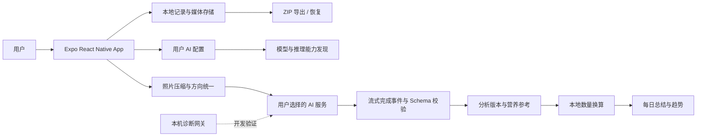

# 健康罗盘技术路线图

更新日期：2026-10-21。本文件描述现行技术方向与验收顺序；文档分工和分轮证据见 [文档索引](README.md)。阶段状态表示实现进展，不能替代真实营养、双端设备或发布验收。

## 总体方向

健康罗盘采用“本地优先、AI 可替换、用户掌握数据”的技术路线：

- 手机 App 使用 Expo、React Native 和 TypeScript，同时支持 Android、iOS，Web 仅用于开发预览。
- 原始照片、视频、健康记录、AI 输入和分析版本优先保存在本地。
- 用户自行填写 API URL、Key、模型和推理强度；App 不绑定单一 AI 服务。
- AI 负责识别、解释和给出每100g营养参考；本地按一般成人或用户体重预填可修改的参考食用量，确认后据此或用户填写的数量计算营养，估量不作为照片测重。
- 所有原始数据和分析版本都可导出，未来更换模型后仍可继续分析。
- 服务端网关只用于本地开发、协议测试和真实验证，不作为手机 App 的固定后端。

## 路线阶段

| 阶段 | 技术方向 | 当前状态 | 进入下一阶段的验收条件 |
|---|---|---|---|
| P0：合同与基础架构 | 固定数据版本、AI 请求协议、超时语义、错误分类、备份格式和隐私边界 | 大部分已实现 | 类型、协议、迁移和备份契约稳定，新增字段向后兼容 |
| P1：本地健康数据底座 | 本地保存饮食、训练、睡眠、照片、视频、分析版本和 Markdown 总结；原始数据与派生结果分离 | 已实现基础版本 | 杀进程、重启、删除、导出、恢复和损坏备份均可验证 |
| P2：饮食拍照与营养核心 | 同餐多图预处理、模型发现、流式请求、严格响应校验、自适应复核、每 100 g AI 参考、本地默认量与用户数量换算 | 已实现；默认量与确认同步有分轮 Web 模拟证据，真实稳定性待验 | 完整响应才能确认；复核超时保留首轮；改菜先更新参考；旧量冻结、主动清空、离线重算和媒体备份可验证 |
| P3：综合健康管理 | 训练记录、渐进超负荷反馈、睡眠记录、趋势和每日总结与饮食数据打通 | 已有可用基础 | 三个模块均能独立记录、编辑、删除、导出，并出现在每日摘要中 |
| P4：真实验证与质量控制 | 50 餐真值集、主要食材召回率、营养区间覆盖率、无法估算率、延迟和请求次数统计 | 真值集仍待人工补全 | 主要食材召回率 ≥80%，营养区间覆盖率 ≥80%，无法估算率 ≤20%，每餐最多 3 次请求 |
| P5：移动端发布准备 | Android arm64 真机测试、iOS 构建与真机测试、权限、升级安装、数据保留、隐私说明 | 2026-10-19 的 0.1.1 APK 已做限定 x86_64 模拟器验证；不含 10 月 20～21 日工作树更新，实体手机/iOS 未验收 | 当前源码重建后完成 Android 与 iOS 主要流程；升级不丢数据；无 Key、开发网关或调试配置泄漏 |
| P6：后续扩展 | Oura 等穿戴设备、训练视频辅助、多模型对比、可选同步服务、加密备份 | 暂不进入首版 | 只有在 P1～P5 稳定后再增加，避免影响核心记录链路 |

## 关键接口与数据原则

- **记录层**：饮食、训练、睡眠记录保存原始输入、修改版本和时间信息；AI 结果属于派生版本，不能覆盖原始记录。
- **AI 配置层**：URL、Key、协议、模型和推理强度由用户配置；原生使用 SecureStore，Web 使用独立 IndexedDB，事务提交后才提示成功。同一浏览器和固定 `http://localhost:8081/` 来源重开恢复，健康 ZIP 不含连接配置或 Key。
- **模型请求层**：支持 Responses 和 Chat Completions；模型列表与推荐强度选项来自上游能力信息，不自行猜测。用户也可明确填写自定义强度 token，按原值发送并保存；服务默认省略该参数，不自动换档。
- **餐食分析层**：模型仅按前端所需 JSON 返回菜品或饮品、做法、识别置信度、每100g四项营养参考、配方依据和不确定性；目录ID、候选列表、区域、来源元数据、覆盖统计和总量不由模型生成。体重与默认数量计算留在本地，原始模型数量保持为空。
- **营养计算层**：有效热量目标优先，否则按一般成人60kg/有效个人体重生成参考量，并结合菜品热量预填克数；用户可改为克数或可靠家用份数。明确确认后计算营养并同步菜品名称，估算来源、用户修改与主动清空分别保存；没有可用数量或营养时未知，不填零。改菜名造成旧参考失效时须更新每100g参考，不能套用旧菜数据。
- **请求生命周期**：整图分析、必要时局部复核、只有身份冲突时最终合并；每餐最多 3 次，不自动重试；只有完整完成事件和业务校验都通过才算成功。
- **延迟策略**：普通阶段默认等待 120 秒；前端每秒显示累计等待时间，完成、取消或失败后停止。180 秒只用于显式慢供应商诊断。`max` 推理过慢时显示失败或超时，不偷偷替换用户选择。
- **备份层**：ZIP 同时保存原始数据、原始媒体、输入快照、分析版本、模型来源和修正记录，保证换模型后仍能重新分析。

## 验收与发布门槛

每个阶段完成后执行对应检查：

- 静态与单元测试：`npm run typecheck`、`npm test`、`npm run test:server`。
- 诊断与评估工具：`npm run test:scripts`，与业务测试分开报告。2026-10-21 最新脚本专项 132/132 通过；历史试验显式使用自身冻结的 90 秒参数，和 App 的 120 秒默认值独立。修复前结果及边界见 [脚本说明](../scripts/README.md) 与 [维护审查](maintenance-review.md)。
- Web 流程：覆盖拍照上传、分析回填、数量修改、训练、睡眠、摘要、导出和恢复。
- 协议安全：拒绝错误包装、伪造营养总量、无效模型 ID、未完成流、超时和迟到响应。
- 数据安全：APK 扫描不得包含 API Key、开发访问令牌、本机网关地址或编译环境变量。
- 真实餐食：每餐记录模型、推理强度、阶段、耗时、HTTP 状态、完成事件、是否接受和 usage；失败记录不能被覆盖。
- 移动端：至少一台 arm64 Android 真机完成安装、升级、相机/相册权限、照片分析、数据恢复和删除验证；iOS 通过对应构建和设备验证。
- 发布前文档：产品规格、技术路线、数据导出格式、AI 费用提示、隐私边界和已知限制保持一致。

## 文档落点与边界

本路线图是技术方向和验收顺序的总览。产品行为以 [产品规格](product-spec-v0.1.md) 为准，实际开发与验证状态以 [开发记录](development.md) 为准，营养协议以 [营养实现规格](nutrition-implementation.md) 为准。

P2 的端到端实现、阶段关系、失败分支、营养公式和测试映射见 [饮食拍照与营养核心技术报告](p2-meal-analysis-technical-report.md)。

默认不写日历日期，而使用阶段依赖和验收门槛推进。首版不包含工作/生活事务管理、强制云同步、自动穿戴设备接入、精确称重替代和收费功能；这些保持为后续扩展方向。
